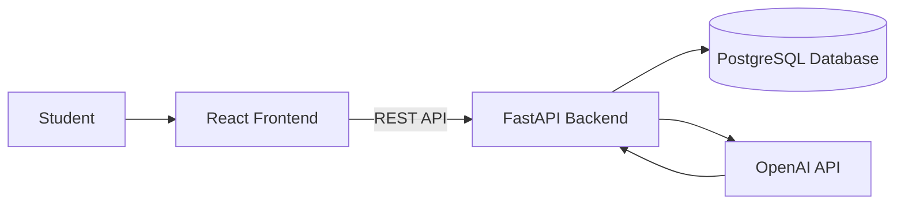

# StudySync AI

## Overview

StudySync AI is an AI-powered academic planning web application designed to help college students organize their courses, assignments, exams, deadlines, and study time in one centralized platform.

The application will analyze a student's academic workload and available study time to generate personalized study plans and recommendations.

## Main Features

* User registration and authentication
* Course management
* Assignment and exam tracking
* Deadline and priority management
* Academic calendar and dashboard
* Student study-time availability
* AI-generated personalized study plans
* Study progress tracking

## Technology Stack

### Frontend

* React
* TypeScript
* Vite
* Tailwind CSS

### Backend

* Python
* FastAPI
* SQLAlchemy

### Database

* PostgreSQL

### Authentication

* JWT authentication
* Secure password hashing

### AI

* OpenAI API

## System Architecture



## Project Team

* Kiamely Pereyra 
* Massiel Montero

## Project Status

Currently developing the project proposal and opportunity study for Milestone 1.

## Local PostgreSQL Setup

The backend uses PostgreSQL to store tasks permanently.

### Requirements

- Python 3.12
- Docker Desktop
- PostgreSQL runs through Docker Compose

### Setup

1. Copy `.env.example` to a new file named `.env`.
2. Replace `replace_with_your_local_password` in both variables with the same local password.
3. Start Docker Desktop.
4. From the project root, start PostgreSQL:

   ```bash
   docker compose up -d db
   ```

5. Install the backend dependencies:

   ```bash
   cd backend
   python -m pip install -r requirements.txt
   ```

6. Create the database tables:

   ```bash
   python -c "from app.database import Base, engine; import app.models; Base.metadata.create_all(bind=engine)"
   ```

7. Start the backend:

   ```bash
   python -m uvicorn app.main:app
   ```

8. Open http://127.0.0.1:8000/docs to test the API.

### Running Tests

From the `backend` folder:

```bash
python -m pytest -q
```

Tests use an isolated SQLite database, so they do not modify the PostgreSQL task data.

### Database Persistence

PostgreSQL uses a Docker volume to preserve data between container restarts.

To stop the database without deleting its data:

```bash
docker compose down
```
