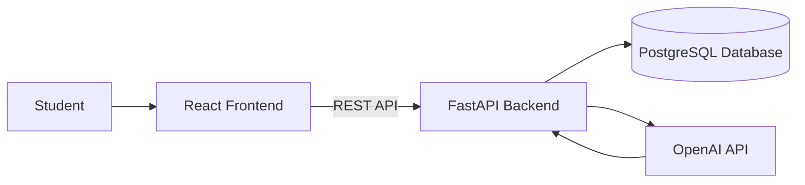

# StudySync AI

## Overview

StudySync AI is an AI-powered academic planning web application designed to help college students organize their courses, assignments, exams, deadlines, and study time in one centralized platform.

The application will analyze a student's academic workload and available study time to generate personalized study plans and recommendations.

## Main Features

* User registration and authentication
* Course management
* Assignment and exam tracking
* Deadline and priority management
* Academic calendar and dashboard
* Student study-time availability
* AI-generated personalized study plans
* Study progress tracking

## Technology Stack

### Frontend

* React
* TypeScript
* Vite
* Tailwind CSS

### Backend

* Python
* FastAPI
* SQLAlchemy

### Database

* PostgreSQL

### Authentication

* JWT authentication
* Secure password hashing

### AI

* OpenAI API

## System Architecture



## Project Team

* Kiamely Pereyra 
* Massiel Montero


## Project Status

Milestone 4 — Core MVP implementation.

The current MVP allows students to create academic tasks, view saved tasks, and track assignment deadlines. Tasks are stored in PostgreSQL through a FastAPI backend and displayed in the React frontend.

AI-generated study plans, authentication, and additional academic planning features are planned for future milestones.

## Running the Application with Docker

### Requirements

- Docker Desktop
- Git

### Setup

1. Clone the repository.
2. Copy `.env.example` to `.env`.
3. Replace the placeholder password with a local password.
4. Start Docker Desktop.
5. From the project root, run:

```bash
docker compose up --build
```

### Application URLs

- Frontend: http://localhost:5173/
- Backend API documentation: http://localhost:8000/docs
- Health check: http://localhost:8000/health

### Stop the Application

```bash
docker compose down
```

PostgreSQL data persists in a Docker volume.

## Testing

From the `backend` directory, run:

```bash
python -m pytest tests -v
python -m ruff check .
python -m mypy --explicit-package-bases app
```

The backend currently has 13 automated tests covering API functionality, input validation, and task operations.

Manual testing results are documented in `docs/milestone-4/manual-tests.md`.


### Run All Backend Checks

From the project root, run this command in PowerShell:

```powershell
.\run-tests.ps1
```

This runs:
- 13 automated tests using Pytest
- Code quality checks using Ruff
- Type checking using Mypy

All checks must pass before merging changes.


## Project Structure

- `frontend/` — React and TypeScript application
- `backend/app/` — FastAPI application, database models, and API routes
- `backend/tests/` — Automated backend tests
- `docs/` — Requirements, architecture, and milestone documentation
- `compose.yaml` — Docker Compose configuration
- `.env.example` — Environment variable template

## Current Limitations

- AI-generated study plans are not yet implemented.
- Authentication is planned for a future milestone.
- Additional features and testing will be developed in Milestones 5 and 6.

