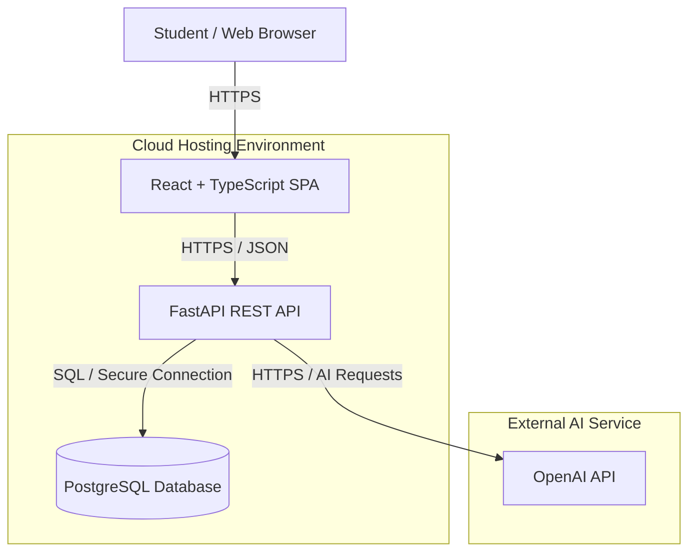
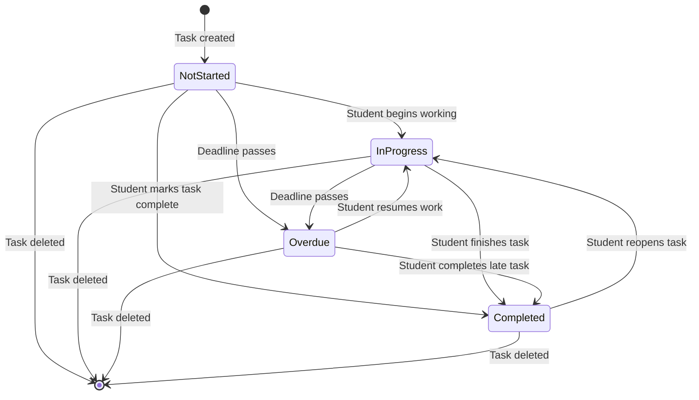
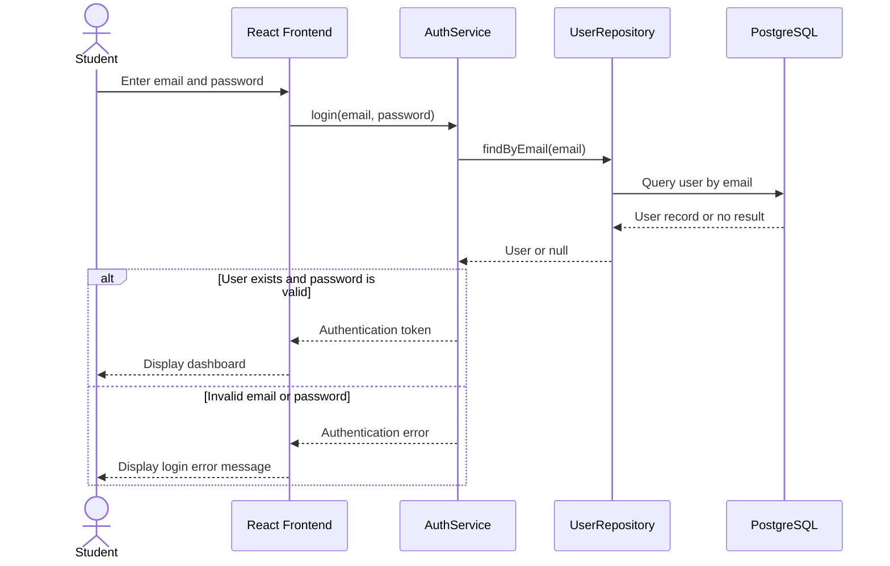
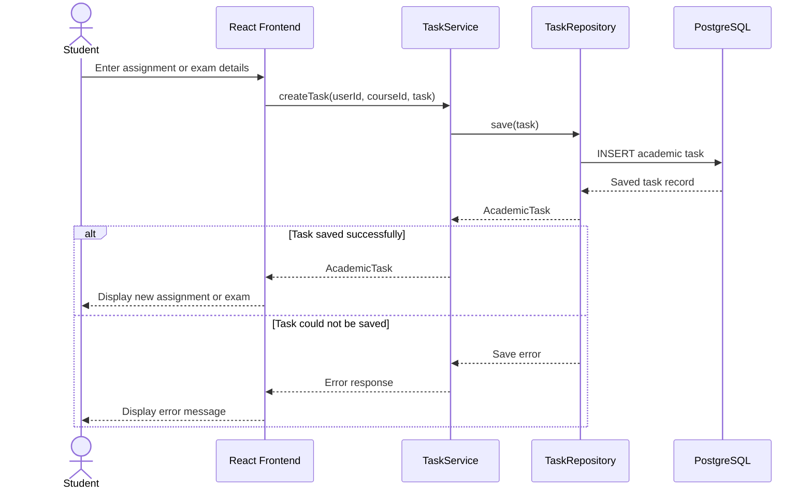
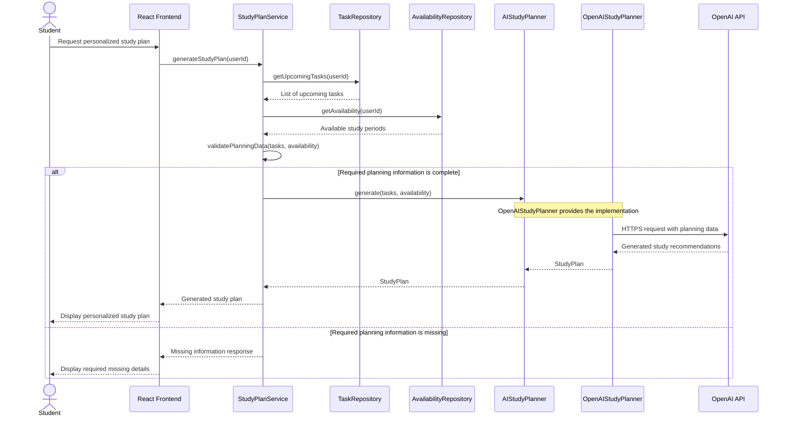
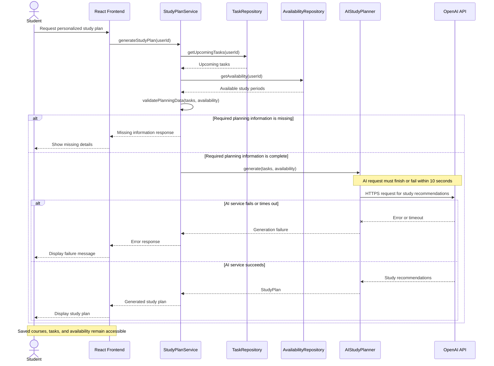
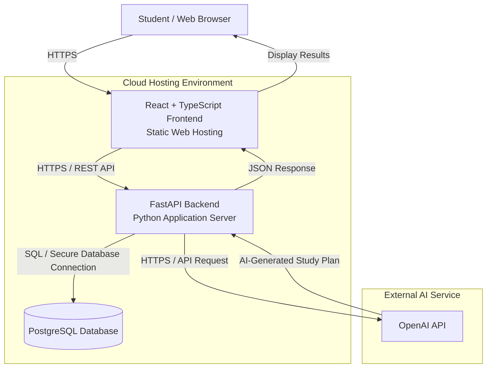
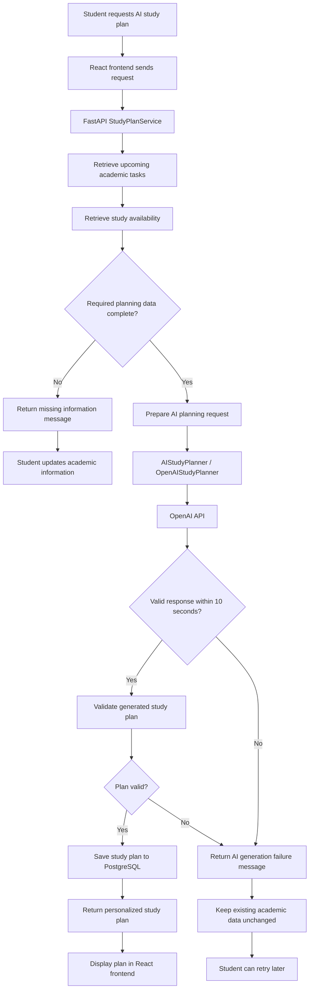

# StudySync AI
## Milestone 3: Formal Analysis & Design Report

### 1. Title Page

**Project:** StudySync AI  
**Milestone:** 3 – Formal Analysis & Design  
**Course:** COMP 425 – Software Engineering  
**University:** Southwest Minnesota State University  
**Team Members:** Kiamely Pereyra Villar and Massiel  
**Submission Date:** October 23, 2026  
**GitHub Repository:** https://github.com/kpv17codes/studysync-ai  
**GitHub Milestone Tag:** To be created before submission

**Team Responsibilities:**
- Kiamely Pereyra: System design, class relationships, state diagram, AI pipeline, documentation, and peer review.
- Massiel Montero: Sequence diagrams, ERD, deployment diagram, documentation, and peer review.
- Both members: Architecture planning, requirements alignment, design review, and final report preparation.

### 2. Executive Summary

StudySync AI is a web-based academic management application designed to help college students organize their courses, assignments, exams, and study schedules. The system combines traditional academic planning tools with artificial intelligence to generate personalized study plans based on upcoming deadlines, task difficulty, estimated study time, and student availability.

Students interact with the application through a React and TypeScript frontend, while a Python FastAPI backend manages authentication, academic information, and study-plan generation. PostgreSQL stores student accounts, courses, academic tasks, availability, and generated study plans. The application integrates with the OpenAI API to generate study recommendations using validated academic information.

Three key design decisions guide the system:

1. **Separation of responsibilities:** The React frontend, FastAPI backend, and PostgreSQL database operate as separate components to support maintainability, testing, and future deployment.

2. **Validated AI integration:** The system checks that all required planning information is complete before requesting an AI-generated study plan. Missing information, invalid responses, and service failures are handled without losing previously saved academic data.

3. **Modular and secure architecture:** The design uses service and repository interfaces, JWT authentication, secure API communication, and environment-based configuration. Docker and GitHub Actions are planned to support consistent deployment and automated workflows.

The formal design includes container, class, sequence, state, entity relationship, deployment, and AI pipeline diagrams. Together, these diagrams translate the Milestone 2 requirements into a technical design that will guide implementation, testing, and deployment in subsequent milestones.

### 3. Changes Since Milestone 2

The Milestone 2 Software Requirements Specification (SRS) serves as the baseline for the formal system design. During Milestone 3, the team translated the approved requirements into architectural, structural, behavioral, data, deployment, and AI pipeline diagrams.

No formal additions, removals, or modifications to the finalized Milestone 2 requirements have been identified at this stage.

| Change Type | Description | Reason |
|---|---|---|
| Added requirements | None identified | The existing SRS provides the requirements baseline for Milestone 3. |
| Modified requirements | None identified | Existing requirements are being translated into technical design decisions without changing their intended behavior. |
| Removed requirements | None identified | No previously documented requirements have been intentionally removed. |

The design provides additional implementation details for AI study-plan readiness checks, fallback behavior, the 10-second response requirement, database relationships, and deployment architecture. These are design elaborations rather than confirmed changes to the SRS.

Any differences discovered during the final consistency review will be documented and reconciled before submission.

### 4. Architecture Overview

#### 4.1 Container Diagram

The Container Diagram illustrates the major components of StudySync AI, where they are hosted, and how they communicate. The system follows a three-tier web application architecture with an external AI integration.

#### 4.2 Architecture Description

The architecture consists of five primary components:

1. **Student / Web Browser:** Provides access to the application for managing courses, academic tasks, availability, and study plans.
2. **React + TypeScript Frontend:** Provides the user interface and communicates with the backend through HTTPS and JSON-based API requests.
3. **FastAPI Backend:** Handles authentication, academic data management, input validation, and AI study-plan generation.
4. **PostgreSQL Database:** Stores student accounts, courses, assignments, exams, study availability, and generated study plans.
5. **OpenAI API:** Provides AI-generated study recommendations based on validated academic information.

#### 4.3 Key Design Considerations

The frontend, backend, and database are designed as separate components to support maintainability and independent deployment.

The OpenAI API is accessed only through the backend so that API credentials are not exposed to the student's browser.

The diagram represents the proposed cloud architecture. Specific hosting services will be finalized during implementation.

#### 4.4 Requirements Supported

This architecture supports the Milestone 2 requirements for user authentication, course and academic task management, study availability, and AI-generated study planning.

The backend also supports the AI readiness validation and failure-handling requirements by checking required information before invoking the external AI service.

Exact requirement IDs will be added after verification against the finalized Milestone 2 SRS.

### 5. Structural Design

#### 5.1 Class Diagram

The following class diagram shows the main classes used in StudySync AI, including their attributes, methods, and relationships. It represents the structure needed to support user authentication, academic tasks, study availability, and AI-generated study plans.

#### 5.2 State Diagram
The following state diagram shows the lifecycle of an academic task (assignment or exam) in StudySync AI. It illustrates how a task moves between different states as the student works on it, completes it, or passes its deadline.

#### State Diagram Description

The state diagram represents the possible states of an academic task in StudySync AI.

- **Not Started:** The assignment or exam has been created, but the student has not started working on it.
- **In Progress:** The student has started working on the task but has not completed it.
- **Completed:** The student has finished the task and marked it as complete.
- **Overdue:** The task's deadline has passed without completion.

A task begins in the Not Started state when it is created. The student can move it to In Progress or Completed. If its deadline passes before completion, the task becomes Overdue.

Overdue tasks can still be worked on and completed. Students can also reopen completed tasks if additional work is needed.

Deleting a task ends its lifecycle, regardless of its current state.

### 6. Behavioral Design

The following sequence diagrams show how the main components of StudySync AI communicate during important user actions. They include successful operations and error-handling scenarios.
#### Sequence Diagram 1: User Login

**Use Case:** UC-02 — Log In

**Preconditions:** The student has a registered account and can access the login page.

**Purpose:** Demonstrates how the system validates login credentials, grants access when authentication succeeds, and displays an error when credentials are invalid.

**Requirements Supported:** FR-102, FR-103, NFR-05, NFR-06.

This diagram shows how a student logs into StudySync AI using their email and password. The backend checks the user's credentials and either allows access or returns an error message.

**Sequence Diagram 1 Description**
The student enters their login credentials through the React frontend. The frontend sends the login request to the authentication service, which uses the user repository to retrieve the account information from PostgreSQL.
If the credentials are valid, the authentication service returns a token and the student can access the dashboard. Otherwise, the frontend displays an error message without granting access.

#### Sequence Diagram 2: Add Assignment or Exam

**Use Case:** UC-04 — Manage Assignments and Exams

**Preconditions:** The student is authenticated and has an existing course to associate with the academic task.

**Purpose:** Demonstrates how assignment or exam information is validated and saved, including error handling when the request is unsuccessful.

**Requirements Supported:** FR-301, FR-302, NFR-06.

This diagram shows how a student adds a new assignment or exam to a course. The backend processes the task information, saves it to the database, and confirms whether the task was created successfully.

**Sequence Diagram 2 Description**
The student enters the assignment or exam information through the React frontend, including its course, title, deadline, difficulty, and estimated study time.
The `TaskService` receives the request and uses `TaskRepository` to save the academic task in PostgreSQL. If the operation succeeds, the frontend displays the newly created task. If saving fails, the student receives an error message.

#### Sequence Diagram 3: Generate AI Study Plan

**Use Case:** UC-07 — Generate AI Study Plan

**Preconditions:** The student is authenticated and has entered academic tasks and study availability. Required planning information must be complete before the AI service is called.

**Purpose:** Demonstrates validation of planning information, interaction with the AI service, and the successful generation of a personalized study plan.

**Requirements Supported:** FR-601, FR-602, FR-603, FR-604, FR-606.

This diagram shows how StudySync AI generates a personalized study plan using upcoming academic tasks, deadlines, difficulty levels, estimated study hours, and the student's available study time.

**Sequence Diagram 3 Description**
The student requests a personalized study plan through the React frontend. The `StudyPlanService` retrieves upcoming academic tasks and study availability from the corresponding repositories.
Before contacting the AI service, the system verifies that all required planning information is available, including task deadlines, difficulty levels, estimated study hours, and at least one available study period.
When the required information is complete, `StudyPlanService` uses the `AIStudyPlanner` interface, implemented by `OpenAIStudyPlanner`, to request personalized recommendations from the OpenAI API.
If required information is missing, the system identifies the missing details and does not attempt AI generation. This supports FR-606 from our Milestone 2 requirements.

#### Sequence Diagram 4: AI Service Failure and Timeout

**Use Case:** UC-07 — Generate AI Study Plan (Failure Scenario)

**Preconditions:** The student is authenticated, required planning information is complete, and a study-plan generation request has been initiated.

**Purpose:** Demonstrates how the system handles an AI service error or timeout without displaying an incomplete plan or losing previously saved academic information.

**Requirements Supported:** FR-605, FR-606, NFR-03, NFR-07, NFR-08, NFR-09.

This diagram shows how StudySync AI handles an unsuccessful AI study-plan request. The system must return an error within 10 seconds and allow students to continue using their saved academic information.

**Sequence Diagram 4 Description**
When a student requests an AI-generated study plan, the system first checks whether the required planning information is complete.
If the information is missing, the student receives a message identifying the missing details without contacting the AI service.
If the information is complete, the system sends the request to the AI planner. If the OpenAI API fails or does not respond within the 10-second limit, StudySync AI displays an error instead of an incomplete study.

### 7. Data Design

#### 7.1 Entity Relationship Diagram (ERD)

Entity Relationship Diagram (ERD)
The following ERD shows the proposed PostgreSQL database structure for StudySync AI. It includes student accounts, courses, academic tasks, study availability, generated study plans, and individual study-plan entries.

manages

defines

receives

contains

includes

referenced_by

USERS

int

user_id

PK

string

name

string

email

UK

string

password_hash

COURSES

int

course_id

PK

int

user_id

FK

string

name

string

code

ACADEMIC_TASKS

int

task_id

PK

int

course_id

FK

string

title

string

task_type

date

deadline

int

difficulty

float

estimated_hours

string

status

STUDY_AVAILABILITY

int

availability_id

PK

int

user_id

FK

datetime

start_time

datetime

end_time

STUDY_PLANS

int

plan_id

PK

int

user_id

FK

datetime

generated_at

string

plan_content

STUDY_PLAN_ENTRIES

int

entry_id

PK

int

plan_id

FK

int

task_id

FK

datetime

start_time

datetime

end_time

string

recommendation

ERD Description
The database contains six main tables:

USERS: Stores student account information, including names, email addresses, and hashed passwords.

COURSES: Stores courses created by students. Each course belongs to one user, and a user can manage multiple courses.

ACADEMIC_TASKS: Stores assignments and exams, including their deadlines, difficulty levels, estimated study hours, and current status. Each task belongs to one course.

STUDY_AVAILABILITY: Stores the time periods when students are available to study. Each availability record belongs to one user.

STUDY_PLANS: Stores generated study plans and their creation dates. Each plan belongs to one user.

STUDY_PLAN_ENTRIES: Stores individual recommended study sessions within a generated plan. Each entry belongs to one study plan and references an academic task.

The primary keys (PK) uniquely identify records, while foreign keys (FK) connect related tables. The user's email has a unique constraint (UK).

The relationships use one-to-many cardinalities. For example, one student can have multiple courses, and one course can contain multiple assignments or exams.

The STUDY_PLAN_ENTRIES table connects generated study sessions to their corresponding academic tasks, allowing one task to appear in multiple study plans.

This database design supports the main StudySync AI features, including academic organization, task tracking, study availability, and personalized AI study planning.

### 8. Deployment and DevOps

#### 8.1 Deployment Diagram

The following diagram shows the proposed deployment architecture for StudySync AI. It illustrates how the React frontend, FastAPI backend, PostgreSQL database, and external OpenAI API will communicate in a cloud-hosted environment.

#### Deployment Diagram Description

The deployment architecture consists of the following components:

1. **Student / Web Browser:** Students access StudySync AI through a web browser.
2. **React Frontend:** The React and TypeScript application is deployed using static web hosting and provides the user interface for managing courses, assignments, exams, and study plans.
3. **FastAPI Backend:** The Python FastAPI application is deployed on a cloud application server. It handles authentication, academic data management, study-plan generation, and communication with external services.
4. **PostgreSQL Database:** The database stores student accounts, courses, academic tasks, study availability, and generated study plans.
5. **OpenAI API:** The external AI service processes validated academic information and generates personalized study-plan recommendations.

#### Communication and Security

- Communication between the student's browser, frontend, and backend uses HTTPS.
- The backend communicates with PostgreSQL through a secure database connection.
- The OpenAI API is accessed by the backend using HTTPS, keeping API credentials out of the frontend.
- Student passwords are stored as secure password hashes rather than plaintext.
- JWT authentication is used to protect authenticated API requests.
- Environment variables are used to manage database credentials, API keys, and other sensitive configuration.

#### Deployment Strategy

The proposed deployment will use cloud hosting for the React frontend and FastAPI backend, along with a managed PostgreSQL database.

Docker will be used to package the backend application for consistent deployment across environments. GitHub Actions will support automated testing and deployment workflows.

The final cloud hosting provider and production configuration will be selected during implementation.

This deployment design supports the application's scalability, maintainability, security, and availability requirements.

### 9. AI Feature Design

#### 9.1 AI Pipeline Diagram

The following diagram illustrates how StudySync AI generates personalized study plans using student academic information and an external AI service. It includes data collection, validation, AI processing, and fallback behavior when required information is missing or the AI service fails.

#### AI Pipeline Description

The AI study-plan generation process follows these steps:

1. **Student Request:** The student requests a personalized study plan through the React frontend.
2. **Data Retrieval:** The FastAPI backend retrieves upcoming academic tasks and the student's available study periods from PostgreSQL.
3. **Data Validation:** The system checks that all required information is present, including task deadlines, difficulty levels, estimated study hours, and at least one available study period.
4. **Missing Information:** If any required information is missing, the system displays a message asking the student to complete it without calling the AI service.
5. **AI Processing:** When the required information is complete, the backend prepares the planning request and sends it through the AIStudyPlanner interface to the OpenAI API.
6. **Response Validation:** The system checks whether the AI service returned a usable study plan within the 10-second limit.
7. **Successful Generation:** A valid study plan is saved in PostgreSQL and displayed to the student.
8. **Failure Handling:** If the AI service times out, fails, or returns an invalid plan, the system displays an error message while preserving previously saved academic information.

This pipeline supports the functional requirements for AI study-plan readiness and fallback behavior, as well as the nonfunctional requirements for response time and data preservation.

### 10. Design Decisions

The following decisions define the proposed architecture of StudySync AI. They were selected to support maintainability, secure data handling, reliable AI-assisted planning, and future deployment.

| Design Decision | Alternatives Considered | Reason for Selection |
|---|---|---|
| React with TypeScript for the frontend | Plain JavaScript, server-rendered templates | React supports reusable interface components, while TypeScript helps identify type-related errors during development. |
| FastAPI for the backend | Flask, Django | FastAPI provides Python-based API development, request validation, and a modular structure suitable for integrating AI functionality. |
| PostgreSQL for persistent storage | SQLite, MongoDB | StudySync AI contains structured relationships between users, courses, tasks, availability, and study plans. PostgreSQL supports relational integrity and reliable storage. |
| Separate frontend, backend, and database layers | Monolithic application | Separation of responsibilities improves maintainability, testing, and independent development. |
| JWT-based authentication | Server-side sessions | JWTs support token-based authentication between the React frontend and FastAPI backend. Tokens must be validated and protected appropriately. |
| AIStudyPlanner interface with OpenAIStudyPlanner implementation | Direct OpenAI API calls inside application services | The interface separates study-plan business logic from the external AI provider, making testing and future provider changes easier. |
| Validate required planning information before AI generation | Send incomplete information directly to the AI service | Validation prevents unnecessary API requests and gives students specific feedback about missing information. |
| Enforce a 10-second AI request limit | Wait indefinitely for the AI provider | A bounded request duration prevents students from waiting indefinitely and supports the project's response-time requirement. |
| Preserve existing academic data when AI generation fails | Clear or overwrite existing planning data | Students must retain access to saved courses, tasks, and availability even when AI functionality is unavailable. |
| Docker and GitHub Actions for planned deployment | Manual environment setup and deployment | Containerization and automated checks can improve consistency and repeatability as deployment is implemented. |

### 11. Traceability Matrix

The following matrix maps the functional and non-functional requirements from the Milestone 2 SRS to the proposed Milestone 3 design. Diagram references indicate design coverage, not completed implementation or testing.

#### 11.1 Functional Requirements

| Milestone 2 Requirement | Use Case | Supporting Design Diagrams | Classes / Database Tables |
|---|---|---|---|
| FR-101 | UC-01 | Container, Class, ERD | User, AuthService, UserRepository; USERS |
| FR-102, FR-103, FR-104 | UC-02 | Login Sequence, Class, Container | User, AuthService, UserRepository; USERS |
| FR-201, FR-202, FR-203, FR-204 | UC-03 | Class, ERD, Container | Course, User; COURSES, USERS |
| FR-301, FR-302, FR-303, FR-304, FR-305 | UC-04 | Add Assignment/Exam Sequence, Class, ERD | AcademicTask, TaskService, TaskRepository; ACADEMIC_TASKS, COURSES |
| FR-306, FR-307 | UC-04 | Class, State, ERD | AcademicTask, TaskService; ACADEMIC_TASKS |
| FR-401, FR-402, FR-403 | UC-05 | Class, ERD | StudyAvailability, AvailabilityRepository; STUDY_AVAILABILITY |
| FR-501, FR-502, FR-503, FR-504 | UC-06 | Container, Class, ERD | AcademicTask, Course, TaskService; ACADEMIC_TASKS, COURSES |
| FR-601, FR-602 | UC-07 | AI Generation Sequence, AI Pipeline, Class | StudyPlanService, AIStudyPlanner, OpenAIStudyPlanner, AcademicTask, StudyAvailability; ACADEMIC_TASKS, STUDY_AVAILABILITY |
| FR-603, FR-604 | UC-07 | AI Generation Sequence, AI Pipeline, ERD | StudyPlan, StudyPlanEntry; STUDY_PLANS, STUDY_PLAN_ENTRIES |
| FR-605 | UC-07 | AI Failure/Timeout Sequence, AI Pipeline | StudyPlanService, AIStudyPlanner |
| FR-606 | UC-07 | AI Generation Sequence, AI Failure/Timeout Sequence, AI Pipeline | StudyPlanService, AcademicTask, StudyAvailability; ACADEMIC_TASKS, STUDY_AVAILABILITY |

#### 11.2 Non-Functional Requirements

| Milestone 2 Requirement | Supporting Design | Design Consideration |
|---|---|---|
| NFR-01, NFR-02 | Container, Deployment, ERD | Backend/database design supports the planned 3-second display targets; performance testing remains necessary. |
| NFR-03 | AI Pipeline, AI Failure/Timeout Sequence | AI requests must return a result or failure within 10 seconds. |
| NFR-04 | Container, Deployment | HTTPS protects authentication and academic data in transit. |
| NFR-05 | Class, Login Sequence, ERD | User.passwordHash represents protected password storage rather than plaintext passwords. |
| NFR-06 | Container, Class, ERD | Authentication, authorization, and user ownership checks must isolate student records. |
| NFR-07 | AI Failure/Timeout Sequence, AI Pipeline | AI failures and timeouts produce an error without making the application unusable. |
| NFR-08, NFR-09 | AI Failure/Timeout Sequence, AI Pipeline, ERD | Existing academic information remains accessible and preserved when generation fails. |
| NFR-10 | Container, Deployment | The React interface must support screen widths from 320 to 1920 pixels without horizontal scrolling. |
| NFR-11 | Container, Deployment | Frontend styling must meet WCAG 2.1 Level AA contrast requirements. |
| NFR-12 | Container, Deployment | Primary academic management controls must support keyboard navigation. |

#### 11.3 Traceability Notes

The original SRS defines seven use cases (UC-01 through UC-07). Milestone 3 provides detailed sequence diagrams for login, assignment/exam creation, AI study-plan generation, and AI failure handling. Other requirements are represented through structural, data, architecture, and deployment designs.

The diagrams represent the intended system design. Requirements involving performance, accessibility, security, and reliability must also be verified during implementation and testing.

### 12. Risks and Open Questions

The following risks and open questions have been identified for the proposed StudySync AI design. They will be addressed during implementation, integration, and testing.

#### 12.1 Design Risks

| Risk | Potential Impact | Mitigation Strategy |
|---|---|---|
| OpenAI API unavailability or timeout | Students may be unable to generate study plans. | Enforce the 10-second request limit, display an error, and preserve existing academic data. |
| Incomplete planning information | AI-generated plans may be inaccurate or unusable. | Validate 100% of required planning information before contacting the AI service, as defined in FR-606. |
| Exposure of student academic information | Unauthorized users could access private student records. | Use authentication, user-specific authorization checks, HTTPS, and secure password storage. |
| Inconsistent data relationships | Tasks or study plans could reference missing or incorrect records. | Define foreign keys and relational constraints in PostgreSQL. |
| Scheduling conflicts or unrealistic AI recommendations | Generated study periods may overlap or exceed available study time. | Validate AI output against task deadlines and student availability before accepting a plan. |
| Performance problems | Dashboard loading or AI generation may exceed response-time requirements. | Test performance against the limits specified in NFR-01, NFR-02, and NFR-03. |
| Deployment configuration errors | The frontend, backend, or database may fail to communicate. | Use environment-specific configuration, protected secrets, automated checks, and deployment testing. |
| Accessibility issues | Some students may have difficulty using the application. | Test responsive layouts, color contrast, and keyboard navigation against NFR-10 through NFR-12. |

#### 12.2 Open Questions

1. Which cloud hosting services will be selected for the frontend, backend, and PostgreSQL database?
2. What automated tests and deployment stages will be required in the final GitHub Actions workflow?
3. How will generated study plans be checked for scheduling conflicts before they are saved?
4. How should the application handle a study plan that becomes outdated after a student changes a task deadline or study availability?
5. What additional safeguards are needed to minimize student data shared with the external AI provider?

These questions are implementation and deployment decisions that remain to be finalized. They do not change the functional scope established in Milestone 2.

### 13. Team Contributions

StudySync AI is developed collaboratively by Kiamely Pereyra and Massiel Montero. Both team members contributed to design planning, documentation, and peer review.

| Team Member | Sections and Diagrams Authored / Contributions |
|---|---|
| Kiamely Pereyra | Container architecture diagram and architecture documentation; Class Diagram relationships and consistency updates; AcademicTask State Diagram; AI Pipeline Diagram; Milestone 3 final report organization, written sections, and requirements traceability. |
| Massiel Montero | Four Sequence Diagrams covering login, academic task creation, AI study-plan generation, and failure handling; Entity Relationship Diagram; Deployment Diagram; related diagram documentation and design explanations. |
| Both team members | System architecture discussions, alignment with Milestone 2 requirements, diagram integration, GitHub collaboration, design review, and final submission preparation. |

The contributions above reflect the current Milestone 3 documentation work. Both team members will review the final report and verify the required GitHub deliverables before submission.
