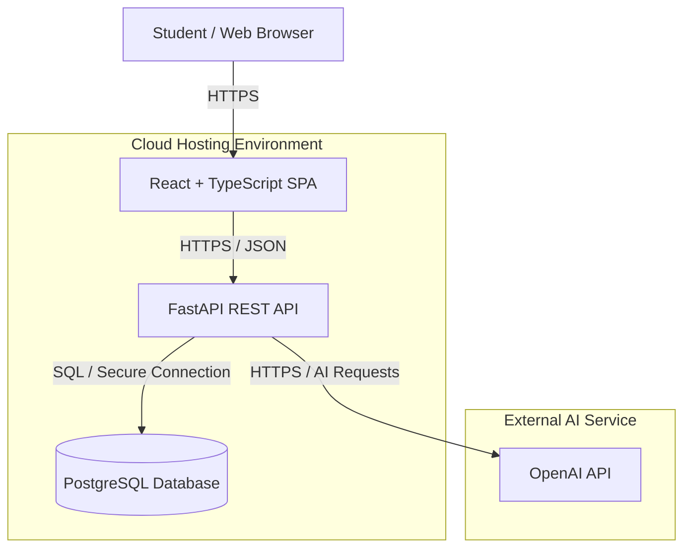
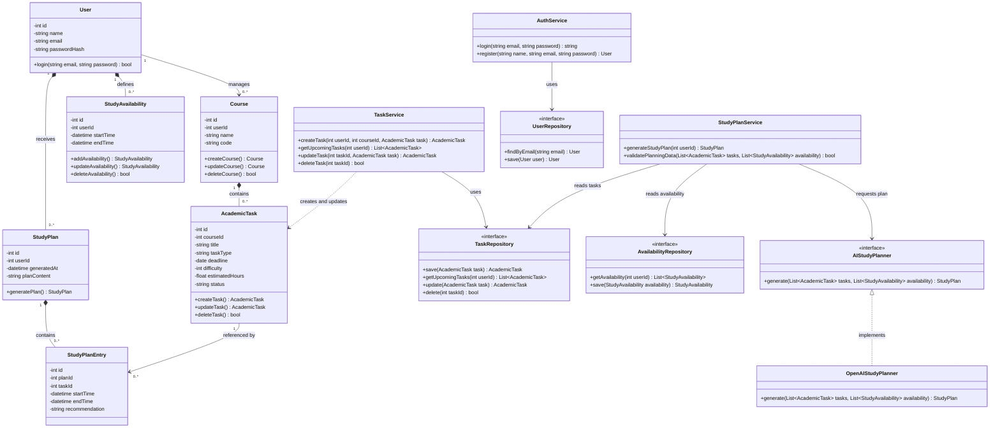
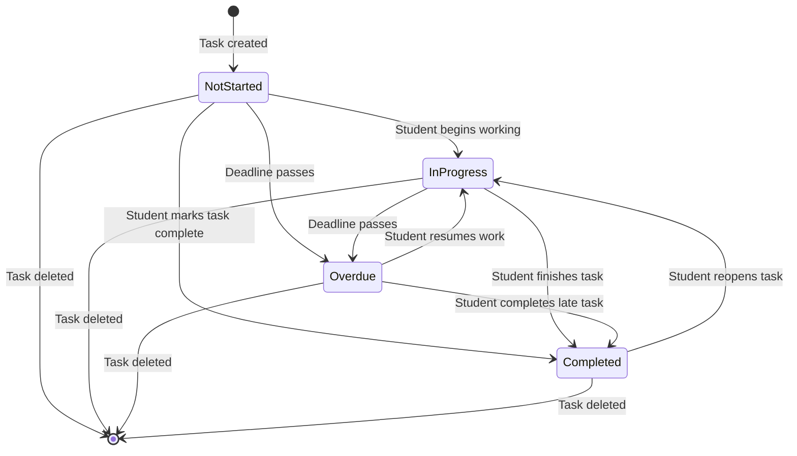
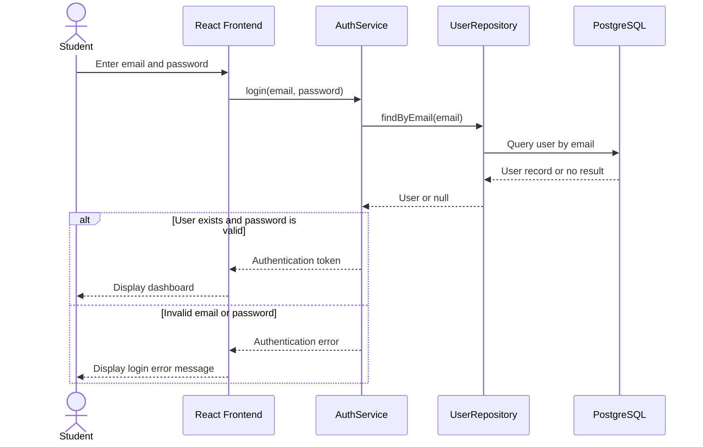
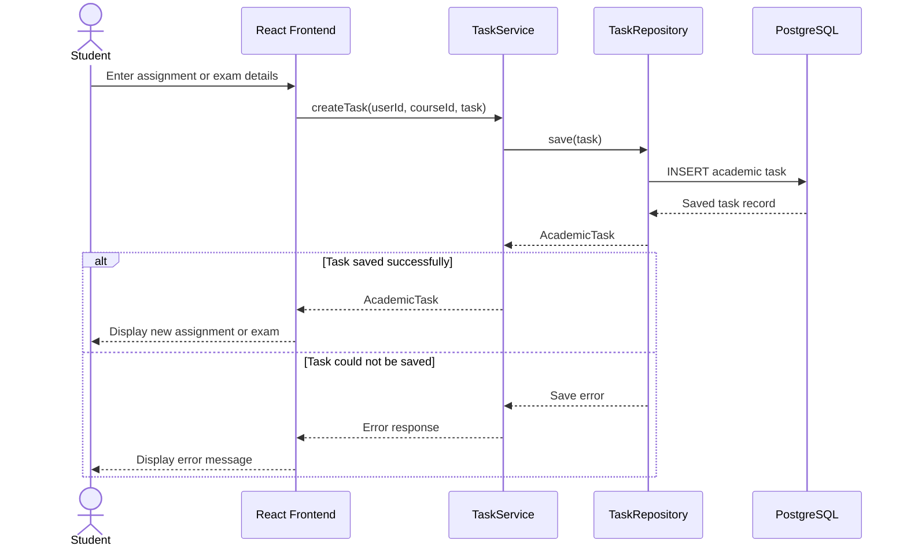
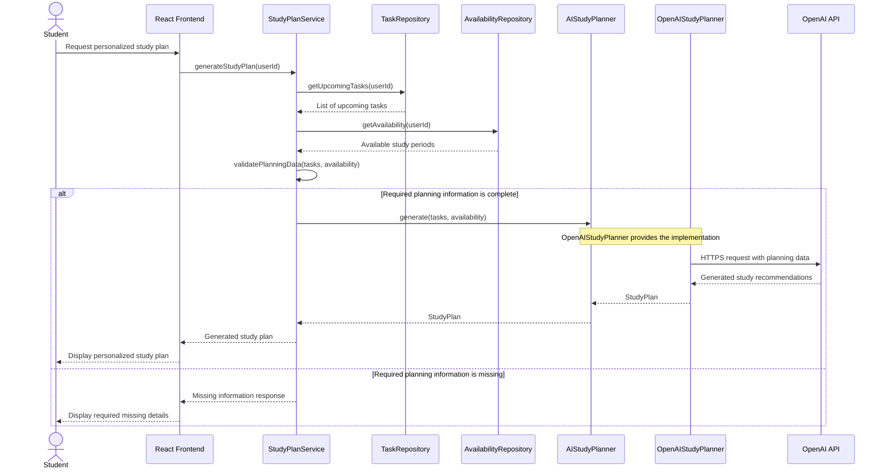
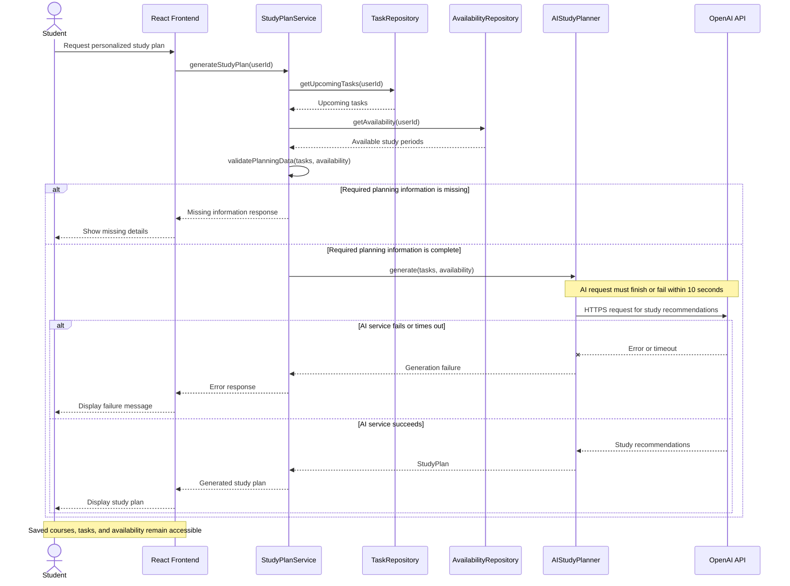

# StudySync AI
## Milestone 3: Formal Analysis & Design Report

### 1. Title Page

**Project:** StudySync AI  
**Milestone:** 3 – Formal Analysis & Design  
**Course:** COMP 425 – Software Engineering  
**University:** Southwest Minnesota State University  
**Team Members:** Kiamely Pereyra Villar and Massiel  
**Submission Date:** October 23, 2026  
**GitHub Repository:** https://github.com/kpv17codes/studysync-ai  
**GitHub Milestone Tag:** To be created before submission

**Team Responsibilities:**
- Kiamely Pereyra: System design, class relationships, state diagram, AI pipeline, documentation, and peer review.
- Massiel Montero: Sequence diagrams, ERD, deployment diagram, documentation, and peer review.
- Both members: Architecture planning, requirements alignment, design review, and final report preparation.

### 2. Executive Summary
### 2. Executive Summary

StudySync AI is a web-based academic management application designed to help college students organize their courses, assignments, exams, and study schedules. The system combines traditional academic planning tools with artificial intelligence to generate personalized study plans based on upcoming deadlines, task difficulty, estimated study time, and student availability.

Students interact with the application through a React and TypeScript frontend, while a Python FastAPI backend manages authentication, academic information, and study-plan generation. PostgreSQL stores student accounts, courses, academic tasks, availability, and generated study plans. The application integrates with the OpenAI API to generate study recommendations using validated academic information.

Three key design decisions guide the system:

1. **Separation of responsibilities:** The React frontend, FastAPI backend, and PostgreSQL database operate as separate components to support maintainability, testing, and future deployment.

2. **Validated AI integration:** The system checks that all required planning information is complete before requesting an AI-generated study plan. Missing information, invalid responses, and service failures are handled without losing previously saved academic data.

3. **Modular and secure architecture:** The design uses service and repository interfaces, JWT authentication, secure API communication, and environment-based configuration. Docker and GitHub Actions are planned to support consistent deployment and automated workflows.

The formal design includes container, class, sequence, state, entity relationship, deployment, and AI pipeline diagrams. Together, these diagrams translate the Milestone 2 requirements into a technical design that will guide implementation, testing, and deployment in subsequent milestones.

### 3. Changes Since Milestone 2

The Milestone 2 Software Requirements Specification (SRS) serves as the baseline for the formal system design. During Milestone 3, the team translated the approved requirements into architectural, structural, behavioral, data, deployment, and AI pipeline diagrams.

No formal additions, removals, or modifications to the finalized Milestone 2 requirements have been identified at this stage.

| Change Type | Description | Reason |
|---|---|---|
| Added requirements | None identified | The existing SRS provides the requirements baseline for Milestone 3. |
| Modified requirements | None identified | Existing requirements are being translated into technical design decisions without changing their intended behavior. |
| Removed requirements | None identified | No previously documented requirements have been intentionally removed. |

The design provides additional implementation details for AI study-plan readiness checks, fallback behavior, the 10-second response requirement, database relationships, and deployment architecture. These are design elaborations rather than confirmed changes to the SRS.

Any differences discovered during the final consistency review will be documented and reconciled before submission.

### 4. Architecture Overview

#### 4.1 Container Diagram

The Container Diagram illustrates the major components of StudySync AI, where they are hosted, and how they communicate. The system follows a three-tier web application architecture with an external AI integration.

#### 4.2 Architecture Description

The architecture consists of five primary components:

1. **Student / Web Browser:** Provides access to the application for managing courses, academic tasks, availability, and study plans.
2. **React + TypeScript Frontend:** Provides the user interface and communicates with the backend through HTTPS and JSON-based API requests.
3. **FastAPI Backend:** Handles authentication, academic data management, input validation, and AI study-plan generation.
4. **PostgreSQL Database:** Stores student accounts, courses, assignments, exams, study availability, and generated study plans.
5. **OpenAI API:** Provides AI-generated study recommendations based on validated academic information.

#### 4.3 Key Design Considerations

The frontend, backend, and database are designed as separate components to support maintainability and independent deployment.

The OpenAI API is accessed only through the backend so that API credentials are not exposed to the student's browser.

The diagram represents the proposed cloud architecture. Specific hosting services will be finalized during implementation.

#### 4.4 Requirements Supported

This architecture supports the Milestone 2 requirements for user authentication, course and academic task management, study availability, and AI-generated study planning.

The backend also supports the AI readiness validation and failure-handling requirements by checking required information before invoking the external AI service.

Exact requirement IDs will be added after verification against the finalized Milestone 2 SRS.

### 5. Structural Design

#### 5.1 Class Diagram

The following class diagram shows the main classes used in StudySync AI, including their attributes, methods, and relationships. It represents the structure needed to support user authentication, academic tasks, study availability, and AI-generated study plans.

#### 5.2 State Diagram
The following state diagram shows the lifecycle of an academic task (assignment or exam) in StudySync AI. It illustrates how a task moves between different states as the student works on it, completes it, or passes its deadline.

#### State Diagram Description

The state diagram represents the possible states of an academic task in StudySync AI.

- **Not Started:** The assignment or exam has been created, but the student has not started working on it.
- **In Progress:** The student has started working on the task but has not completed it.
- **Completed:** The student has finished the task and marked it as complete.
- **Overdue:** The task's deadline has passed without completion.

A task begins in the Not Started state when it is created. The student can move it to In Progress or Completed. If its deadline passes before completion, the task becomes Overdue.

Overdue tasks can still be worked on and completed. Students can also reopen completed tasks if additional work is needed.

Deleting a task ends its lifecycle, regardless of its current state.

### 6. Behavioral Design

The following sequence diagrams show how the main components of StudySync AI communicate during important user actions. They include successful operations and error-handling scenarios.
#### Sequence Diagram 1: User Login
This diagram shows how a student logs into StudySync AI using their email and password. The backend checks the user's credentials and either allows access or returns an error message.

**Sequence Diagram 1 Description**
The student enters their login credentials through the React frontend. The frontend sends the login request to the authentication service, which uses the user repository to retrieve the account information from PostgreSQL.
If the credentials are valid, the authentication service returns a token and the student can access the dashboard. Otherwise, the frontend displays an error message without granting access.
#### Sequence Diagram 2: Add Assignment or Exam
This diagram shows how a student adds a new assignment or exam to a course. The backend processes the task information, saves it to the database, and confirms whether the task was created successfully.

**Sequence Diagram 2 Description**
The student enters the assignment or exam information through the React frontend, including its course, title, deadline, difficulty, and estimated study time.
The `TaskService` receives the request and uses `TaskRepository` to save the academic task in PostgreSQL. If the operation succeeds, the frontend displays the newly created task. If saving fails, the student receives an error message.
#### Sequence Diagram 3: Generate AI Study Plan
This diagram shows how StudySync AI generates a personalized study plan using upcoming academic tasks, deadlines, difficulty levels, estimated study hours, and the student's available study time.

**Sequence Diagram 3 Description**
The student requests a personalized study plan through the React frontend. The `StudyPlanService` retrieves upcoming academic tasks and study availability from the corresponding repositories.
Before contacting the AI service, the system verifies that all required planning information is available, including task deadlines, difficulty levels, estimated study hours, and at least one available study period.
When the required information is complete, `StudyPlanService` uses the `AIStudyPlanner` interface, implemented by `OpenAIStudyPlanner`, to request personalized recommendations from the OpenAI API.
If required information is missing, the system identifies the missing details and does not attempt AI generation. This supports FR-606 from our Milestone 2 requirements.
#### Sequence Diagram 4: AI Service Failure and Timeout
This diagram shows how StudySync AI handles an unsuccessful AI study-plan request. The system must return an error within 10 seconds and allow students to continue using their saved academic information.

**Sequence Diagram 4 Description**
When a student requests an AI-generated study plan, the system first checks whether the required planning information is complete.
If the information is missing, the student receives a message identifying the missing details without contacting the AI service.
If the information is complete, the system sends the request to the AI planner. If the OpenAI API fails or does not respond within the 10-second limit, StudySync AI displays an error instead of an incomplete study.

### State Diagram

The following state diagram shows the lifecycle of an academic task (assignment or exam) in StudySync AI. It illustrates how a task moves between different states as the student works on it, completes it, or passes its deadline.

#### State Diagram Description

The state diagram represents the possible states of an academic task in StudySync AI.

- **Not Started:** The assignment or exam has been created, but the student has not started working on it.
- **In Progress:** The student has started working on the task but has not completed it.
- **Completed:** The student has finished the task and marked it as complete.
- **Overdue:** The task's deadline has passed without completion.

A task begins in the Not Started state when it is created. The student can move it to In Progress or Completed. If its deadline passes before completion, the task becomes Overdue.

Overdue tasks can still be worked on and completed. Students can also reopen completed tasks if additional work is needed.

Deleting a task ends its lifecycle, regardless of its current state.

### 7. Data Design

### 8. Deployment and DevOps

### 9. AI Feature Design

### 10. Design Decisions

### 11. Traceability Matrix

### 12. Risks and Open Questions

### 13. Team Contributions