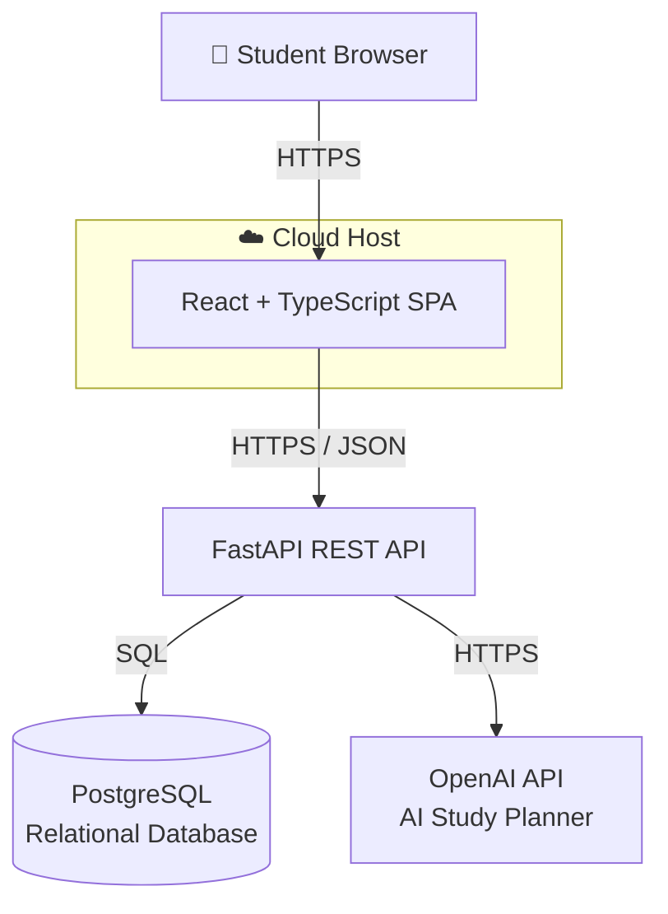
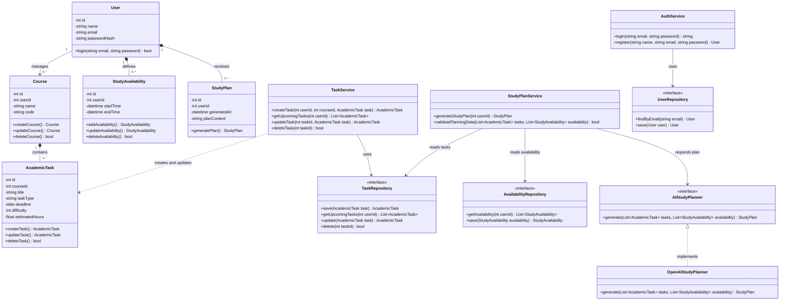
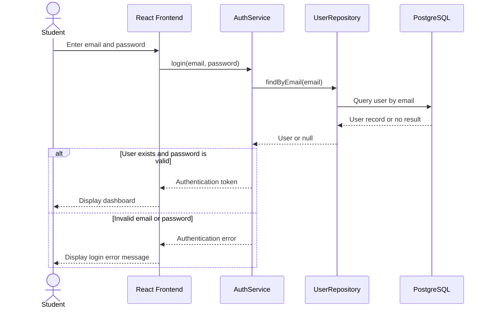
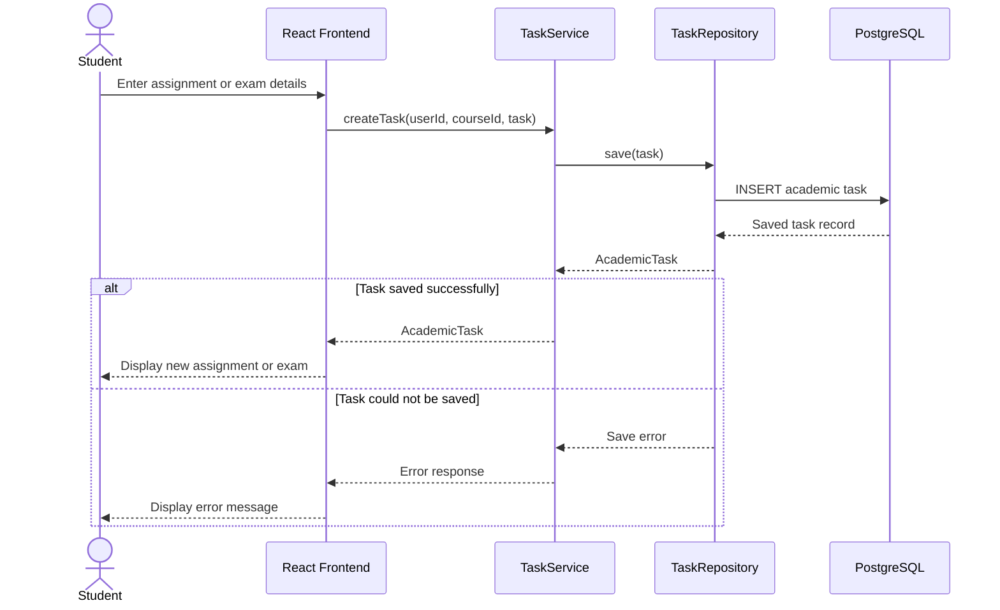
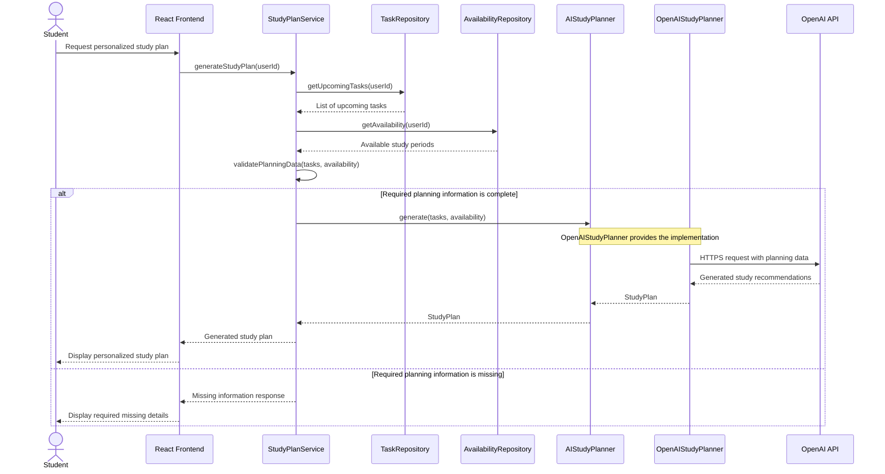
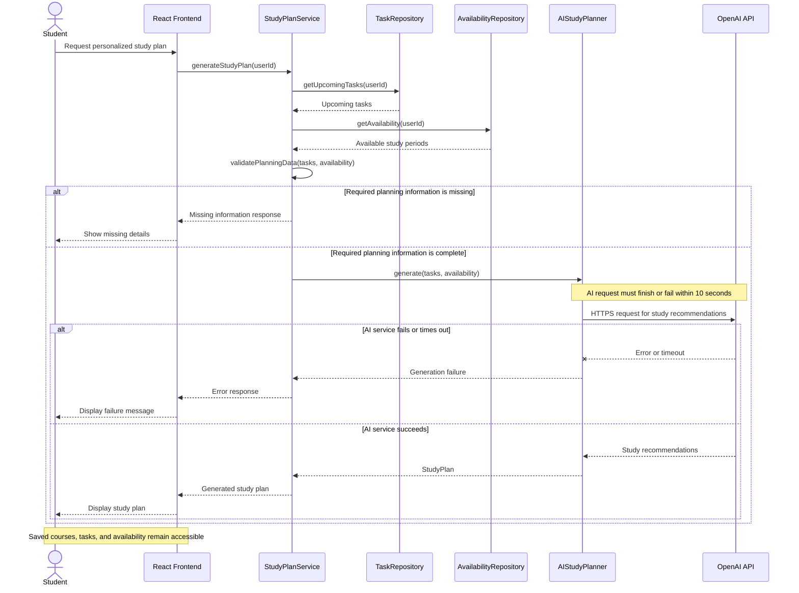
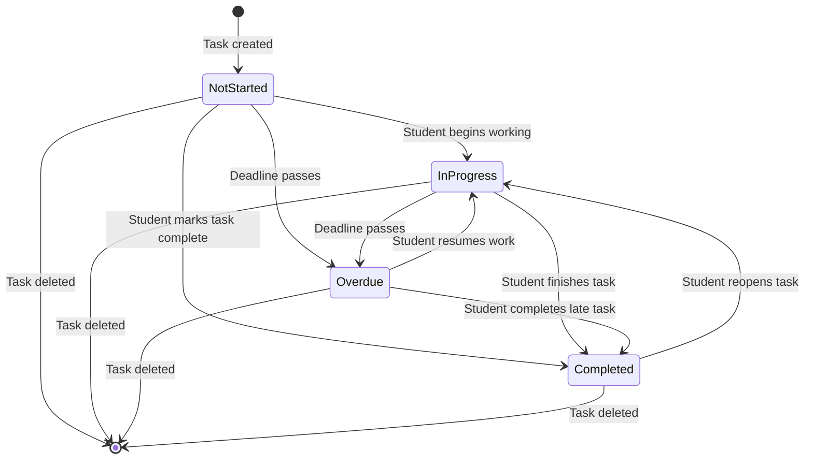
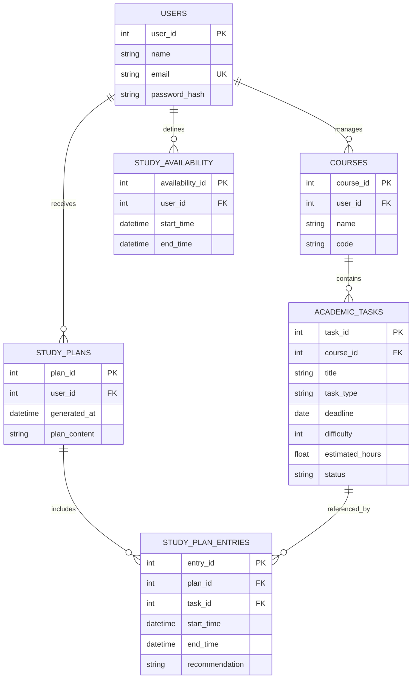
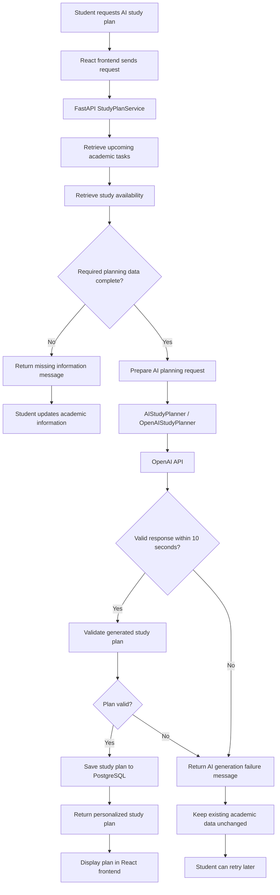

# StudySync AI
## Milestone 3 – Formal Analysis and Design

### System Architecture Diagram

The following diagram shows the high-level architecture of StudySync AI and the communication between the main system components.

### Architecture Description

The student accesses StudySync AI through a web browser. The React and TypeScript frontend provides the user interface and communicates with the FastAPI REST API using HTTPS and JSON.

The FastAPI backend handles application requests and communicates with the PostgreSQL relational database to store and retrieve student information, courses, assignments, exams, study availability, and other academic data.

The backend also communicates with the OpenAI API through HTTPS when AI-powered study planning is requested. The AI service returns generated study recommendations to the backend, which then sends the results to the frontend for the student to view.
### Class Diagram

The following class diagram shows the main classes used in StudySync AI, including their attributes, methods, and relationships. It represents the structure needed to support user authentication, academic tasks, study availability, and AI-generated study plans.

#### Class Diagram Description

The `User` class represents a student account. Each user can own multiple courses, define multiple study availability periods, and receive multiple generated study plans. Each `Course` can contain multiple `AcademicTask` objects representing assignments or exams.

The service classes contain the application logic for authentication, task management, and study-plan generation. Repository interfaces separate the application logic from database access. The `AIStudyPlanner` interface separates AI functionality from the rest of the application, while `OpenAIStudyPlanner` represents the planned implementation using the OpenAI API.

The `StudyPlanService` retrieves upcoming academic tasks and available study periods before requesting a study plan. This supports the requirement that the system verify that the required planning information is available before attempting AI generation.

### Sequence Diagrams

The following sequence diagrams show how the main components of StudySync AI communicate during important user actions. They include successful operations and error-handling scenarios.

#### Sequence Diagram 1: User Login

This diagram shows how a student logs into StudySync AI using their email and password. The backend checks the user's credentials and either allows access or returns an error message.

**Sequence Diagram 1 Description**

The student enters their login credentials through the React frontend. The frontend sends the login request to the authentication service, which uses the user repository to retrieve the account information from PostgreSQL.

If the credentials are valid, the authentication service returns a token and the student can access the dashboard. Otherwise, the frontend displays an error message without granting access.

#### Sequence Diagram 2: Add Assignment or Exam

This diagram shows how a student adds a new assignment or exam to a course. The backend processes the task information, saves it to the database, and confirms whether the task was created successfully.

**Sequence Diagram 2 Description**

The student enters the assignment or exam information through the React frontend, including its course, title, deadline, difficulty, and estimated study time.

The `TaskService` receives the request and uses `TaskRepository` to save the academic task in PostgreSQL. If the operation succeeds, the frontend displays the newly created task. If saving fails, the student receives an error message.

#### Sequence Diagram 3: Generate AI Study Plan

This diagram shows how StudySync AI generates a personalized study plan using upcoming academic tasks, deadlines, difficulty levels, estimated study hours, and the student's available study time.

**Sequence Diagram 3 Description**

The student requests a personalized study plan through the React frontend. The `StudyPlanService` retrieves upcoming academic tasks and study availability from the corresponding repositories.

Before contacting the AI service, the system verifies that all required planning information is available, including task deadlines, difficulty levels, estimated study hours, and at least one available study period.

When the required information is complete, `StudyPlanService` uses the `AIStudyPlanner` interface, implemented by `OpenAIStudyPlanner`, to request personalized recommendations from the OpenAI API.

If required information is missing, the system identifies the missing details and does not attempt AI generation. This supports FR-606 from our Milestone 2 requirements.

#### Sequence Diagram 4: AI Service Failure and Timeout

This diagram shows how StudySync AI handles an unsuccessful AI study-plan request. The system must return an error within 10 seconds and allow students to continue using their saved academic information.

**Sequence Diagram 4 Description**

When a student requests an AI-generated study plan, the system first checks whether the required planning information is complete.

If the information is missing, the student receives a message identifying the missing details without contacting the AI service.

If the information is complete, the system sends the request to the AI planner. If the OpenAI API fails or does not respond within the 10-second limit, StudySync AI displays an error instead of an incomplete study

### State Diagram

The following state diagram shows the lifecycle of an academic task (assignment or exam) in StudySync AI. It illustrates how a task moves between different states as the student works on it, completes it, or passes its deadline.

#### State Diagram Description

The state diagram represents the possible states of an academic task in StudySync AI.

- **Not Started:** The assignment or exam has been created, but the student has not started working on it.
- **In Progress:** The student has started working on the task but has not completed it.
- **Completed:** The student has finished the task and marked it as complete.
- **Overdue:** The task's deadline has passed without completion.

A task begins in the Not Started state when it is created. The student can move it to In Progress or Completed. If its deadline passes before completion, the task becomes Overdue.

Overdue tasks can still be worked on and completed. Students can also reopen completed tasks if additional work is needed.

Deleting a task ends its lifecycle, regardless of its current state.

### Entity Relationship Diagram (ERD)

The following ERD shows the proposed PostgreSQL database structure for StudySync AI. It includes student accounts, courses, academic tasks, study availability, generated study plans, and individual study-plan entries.

#### ERD Description

The database contains six main tables:

1. **USERS:** Stores student account information, including names, email addresses, and hashed passwords.

2. **COURSES:** Stores courses created by students. Each course belongs to one user, and a user can manage multiple courses.

3. **ACADEMIC_TASKS:** Stores assignments and exams, including their deadlines, difficulty levels, estimated study hours, and current status. Each task belongs to one course.

4. **STUDY_AVAILABILITY:** Stores the time periods when students are available to study. Each availability record belongs to one user.

5. **STUDY_PLANS:** Stores generated study plans and their creation dates. Each plan belongs to one user.

6. **STUDY_PLAN_ENTRIES:** Stores individual recommended study sessions within a generated plan. Each entry belongs to one study plan and references an academic task.

The primary keys (PK) uniquely identify records, while foreign keys (FK) connect related tables. The user's email has a unique constraint (UK).

The relationships use one-to-many cardinalities. For example, one student can have multiple courses, and one course can contain multiple assignments or exams.

The `STUDY_PLAN_ENTRIES` table connects generated study sessions to their corresponding academic tasks, allowing one task to appear in multiple study plans.

This database design supports the main StudySync AI features, including academic organization, task tracking, study availability, and personalized AI study planning.

### AI Pipeline Diagram

The following diagram illustrates how StudySync AI generates personalized study plans using student academic information and an external AI service. It includes data collection, validation, AI processing, and fallback behavior when required information is missing or the AI service fails.

#### AI Pipeline Description

The AI study-plan generation process follows these steps:

1. **Student Request:** The student requests a personalized study plan through the React frontend.
2. **Data Retrieval:** The FastAPI backend retrieves upcoming academic tasks and the student's available study periods from PostgreSQL.
3. **Data Validation:** The system checks that all required information is present, including task deadlines, difficulty levels, estimated study hours, and at least one available study period.
4. **Missing Information:** If any required information is missing, the system displays a message asking the student to complete it without calling the AI service.
5. **AI Processing:** When the required information is complete, the backend prepares the planning request and sends it through the AIStudyPlanner interface to the OpenAI API.
6. **Response Validation:** The system checks whether the AI service returned a usable study plan within the 10-second limit.
7. **Successful Generation:** A valid study plan is saved in PostgreSQL and displayed to the student.
8. **Failure Handling:** If the AI service times out, fails, or returns an invalid plan, the system displays an error message while preserving previously saved academic information.

This pipeline supports the functional requirements for AI study-plan readiness and fallback behavior, as well as the nonfunctional requirements for response time and data preservation.