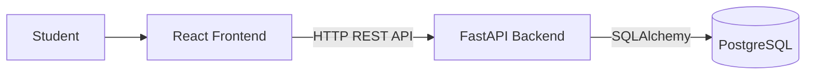
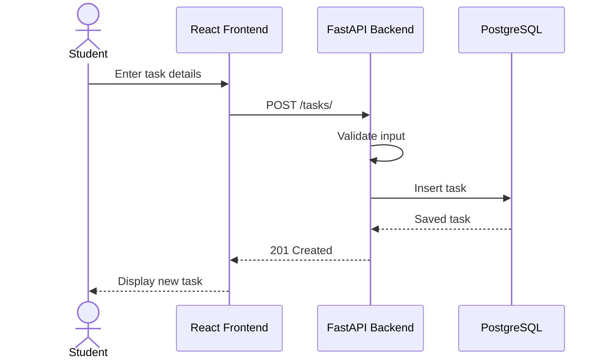

# Milestone 4 — Architecture and Design

## Container Architecture

## Task Creation Sequence

## Changes Since Milestone 3

- Implemented the React task-management dashboard.
- Added FastAPI task creation and retrieval endpoints.
- Integrated PostgreSQL using SQLAlchemy.
- Connected the frontend and backend.
- Added Docker containers for all three services.
- Deferred AI study-plan generation and authentication to future milestones.
